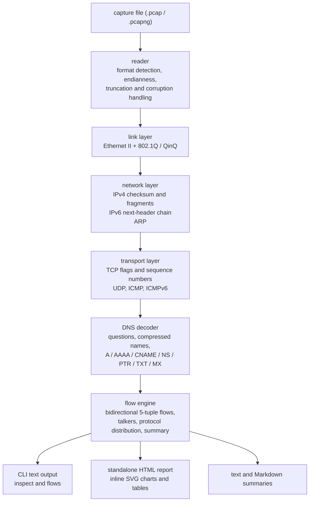

# pcap-inspector

Zero-dependency Python packet capture analyzer for classic pcap and pcapng files: decode Ethernet, VLAN/QinQ, ARP, IPv4, IPv6, TCP, UDP, ICMP, ICMPv6 and DNS, aggregate conversations into flows, and render a self-contained HTML report. It is aimed at network students and administrators who need a readable answer from a capture without installing Wireshark, tcpdump or scapy on the analysis machine.

[](https://github.com/jeremydacosta-TechOptimist/pcap-inspector/actions/workflows/ci.yml)
[](https://github.com/jeremydacosta-TechOptimist/pcap-inspector)
[](LICENSE)

## The problem it solves

A packet capture is only useful if you can read it. Full protocol analyzers are excellent but heavy to install, script and explain, and quick one-liners usually stop at raw hex. `pcap-inspector` is a small, auditable Python package (`pcapkit`) that parses the two common capture formats itself, decodes the layers that matter for everyday troubleshooting (including VLAN-tagged and DNS traffic), and turns a capture into flows, talkers and a report you can attach to an incident ticket. Everything runs locally with the standard library only.

## Features

- **Classic pcap reader** for microsecond and nanosecond captures, little- and big-endian, with honest warnings for truncated or corrupt records instead of a crash.
- **pcapng reader** for Section Header, Interface Description and Enhanced Packet blocks, including interface names, snaplen and timestamp resolution (multi-interface captures keep the interface index on every packet).
- **Protocol decoding**: Ethernet II, 802.1Q VLAN and QinQ stacks, ARP, IPv4 (header length, TTL, protocol, checksum validation, fragmentation flags), IPv6 next-header chains, TCP (ports, flags, sequence numbers, payload length), UDP, ICMP and ICMPv6 echo detection.
- **Compact DNS decoder**: query/response, compressed names, qtype, rcode, and answer records for A, AAAA, CNAME, NS, PTR, TXT and MX.
- **Flow engine**: bidirectional 5-tuple conversations with per-direction packet/byte counts and duration, top talkers, protocol distribution and a capture summary with average pps and bit rate.
- **Self-contained HTML report** with inline SVG bar charts and tables, plus plain-text and Markdown summaries; no external assets, scripts or network access.
- **CLI with useful exit codes**: `demo`, `inspect`, `flows` and `report`, text by default and `--json` for machine-readable output; works as the `pcapkit` console script and as `python -m pcapkit`.
- **Deterministic demo capture**: ARP, DNS, HTTP, ICMP, ICMPv6, 802.1Q and QinQ traffic generated by the tool itself, so the examples below need no external pcap file.

Scope is kept honest: only the Ethernet link type is decoded, DNS is decoded over UDP (not reassembled from TCP), and traffic that is not understood is reported as raw/unknown instead of being guessed.

## Quick start

```powershell
git clone https://github.com/jeremydacosta-TechOptimist/pcap-inspector.git
cd pcap-inspector
pip install -e .
pcapkit demo
```

```text
Created demo.pcap with 27 packets (2.1 KiB captured).
Protocols: TCP 13, DNS 8, ARP 2, ICMP 2, ICMPv6 2
Next steps:
  pcapkit inspect demo.pcap
  pcapkit flows demo.pcap
  pcapkit report demo.pcap -o report.html
```

The demo capture models a small lab: `192.0.2.0/24` local hosts, a DNS resolver at `198.51.100.53`, web and TLS servers at `198.51.100.80` and `203.0.113.50`, plus an IPv6 network under `2001:db8::/32`.

## Usage

### Inspect a capture packet by packet

```powershell
pcapkit inspect demo.pcap
```

```text
Source: demo.pcap
Format: pcap 2.4 (little-endian), link type Ethernet (1), snaplen 65,535
Packets: 27 (0 truncated, 0 with decode errors, 0 capture warning(s))
Time span: 2026-01-15 09:00:00.000000 UTC to 2026-01-15 09:00:00.751300 UTC (751.300 ms)
Average rate: 35.9 pkt/s, 23.1 kbit/s

    #  Timestamp (UTC)            Length  Summary
    1  2026-01-15T09:00:00.000000Z     42  ARP request who-has 192.0.2.20 tell 192.0.2.10
    2  2026-01-15T09:00:00.000950Z     42  ARP reply 192.0.2.20 is-at 02:00:00:00:00:14
    3  2026-01-15T09:00:00.003200Z     75  DNS query www.example.com A (UDP 192.0.2.10:49152 -> 198.51.100.53:53)
    4  2026-01-15T09:00:00.055150Z    127  DNS response www.example.com A rcode=NOERROR answers=2 (UDP 198.51.100.53:53 -> 192.0.2.10:49152)
    5  2026-01-15T09:00:00.120400Z     54  TCP 192.0.2.10:49876 -> 198.51.100.80:80 [SYN] seq=3000000001 ack=0 len=0
    6  2026-01-15T09:00:00.170900Z     54  TCP 198.51.100.80:80 -> 192.0.2.10:49876 [SYN,ACK] seq=2000000001 ack=3000000002 len=0
    7  2026-01-15T09:00:00.172100Z     54  TCP 192.0.2.10:49876 -> 198.51.100.80:80 [ACK] seq=3000000002 ack=2000000002 len=0
    8  2026-01-15T09:00:00.174300Z    144  TCP 192.0.2.10:49876 -> 198.51.100.80:80 [PSH,ACK] seq=3000000002 ack=2000000002 len=90
    9  2026-01-15T09:00:00.231800Z    204  TCP 198.51.100.80:80 -> 192.0.2.10:49876 [PSH,ACK] seq=2000000002 ack=3000000092 len=150
   10  2026-01-15T09:00:00.233000Z     54  TCP 192.0.2.10:49876 -> 198.51.100.80:80 [ACK] seq=3000000092 ack=2000000152 len=0
   11  2026-01-15T09:00:00.240500Z     54  TCP 192.0.2.10:49876 -> 198.51.100.80:80 [FIN,ACK] seq=3000000092 ack=2000000152 len=0
   12  2026-01-15T09:00:00.241200Z     54  TCP 198.51.100.80:80 -> 192.0.2.10:49876 [ACK] seq=2000000152 ack=3000000093 len=0
   13  2026-01-15T09:00:00.242800Z     54  TCP 198.51.100.80:80 -> 192.0.2.10:49876 [FIN,ACK] seq=2000000152 ack=3000000093 len=0
   14  2026-01-15T09:00:00.243400Z     54  TCP 192.0.2.10:49876 -> 198.51.100.80:80 [ACK] seq=3000000093 ack=2000000153 len=0
   15  2026-01-15T09:00:00.300000Z     73  ICMP echo request id=1 seq=1 192.0.2.30 -> 192.0.2.20
   16  2026-01-15T09:00:00.300950Z     73  ICMP echo reply id=1 seq=1 192.0.2.20 -> 192.0.2.30
   17  2026-01-15T09:00:00.400200Z     79  VLAN 100: DNS query api.example.net A (UDP 192.0.2.30:5353 -> 198.51.100.53:53)
   18  2026-01-15T09:00:00.415700Z    111  VLAN 100: DNS response api.example.net A rcode=NOERROR answers=2 (UDP 198.51.100.53:53 -> 192.0.2.30:5353)
   19  2026-01-15T09:00:00.500300Z     84  VLAN 100/200: DNS query mail.example.org MX (UDP 192.0.2.20:49153 -> 198.51.100.53:53)
   20  2026-01-15T09:00:00.530900Z    116  VLAN 100/200: DNS response mail.example.org MX rcode=NOERROR answers=1 (UDP 198.51.100.53:53 -> 192.0.2.20:49153)
   21  2026-01-15T09:00:00.600100Z     94  ICMPv6 echo request id=2 seq=1 2001:db8::10 -> 2001:db8::20
   22  2026-01-15T09:00:00.601050Z     94  ICMPv6 echo reply id=2 seq=1 2001:db8::20 -> 2001:db8::10
   23  2026-01-15T09:00:00.650400Z     95  DNS query api.example.net AAAA (UDP [2001:db8::10]:49154 -> [2001:db8::53]:53)
   24  2026-01-15T09:00:00.680950Z    123  DNS response api.example.net AAAA rcode=NOERROR answers=1 (UDP [2001:db8::53]:53 -> [2001:db8::10]:49154)
   25  2026-01-15T09:00:00.700100Z     54  TCP 192.0.2.30:50000 -> 203.0.113.50:443 [SYN] seq=1500000001 ack=0 len=0
   26  2026-01-15T09:00:00.750600Z     54  TCP 203.0.113.50:443 -> 192.0.2.30:50000 [SYN,ACK] seq=3500000001 ack=1500000002 len=0
   27  2026-01-15T09:00:00.751300Z     54  TCP 192.0.2.30:50000 -> 203.0.113.50:443 [ACK] seq=1500000002 ack=3500000002 len=0

Protocols: TCP 13, DNS 8, ARP 2, ICMP 2, ICMPv6 2
Top talkers: 192.0.2.10 (982 B), 198.51.100.80 (780 B), 198.51.100.53 (592 B), 192.0.2.30 (498 B), 2001:db8::10 (406 B)
```

Use `--limit 0` to list every packet on large captures and `--json` for structured output.

### Aggregate conversations and talkers

```powershell
pcapkit flows demo.pcap
```

```text
Source: demo.pcap (pcap, Ethernet (1))
Packets: 27, bytes: 2,170, duration: 751.300 ms, flows: 8
Protocols: TCP 13, DNS 8, ARP 2, ICMP 2, ICMPv6 2

Top conversations (8 shown, sorted by bytes)
Protocol  Initiator                   Responder                    Packets     Bytes    Duration
------------------------------------------------------------------------------------------------
TCP       192.0.2.10:49876            198.51.100.80:80                  10       780  123.000 ms
UDP       [2001:db8::10]:49154        [2001:db8::53]:53                  2       218   30.550 ms
UDP       192.0.2.10:49152            198.51.100.53:53                   2       202   51.950 ms
UDP       192.0.2.20:49153            198.51.100.53:53                   2       200   30.600 ms
UDP       192.0.2.30:5353             198.51.100.53:53                   2       190   15.500 ms
ICMPv6    2001:db8::10                2001:db8::20                       2       188  950.000 us
TCP       192.0.2.30:50000            203.0.113.50:443                   3       162   51.200 ms
ICMP      192.0.2.30                  192.0.2.20                         2       146  950.000 us

Top talkers (9 shown, sorted by bytes)
Address                                  Packets          Sent      Received         Total
------------------------------------------------------------------------------------------
192.0.2.10                                    12         489 B         493 B         982 B
198.51.100.80                                 10         366 B         414 B         780 B
198.51.100.53                                  6         354 B         238 B         592 B
192.0.2.30                                     7         260 B         238 B         498 B
2001:db8::10                                   4         189 B         217 B         406 B
192.0.2.20                                     4         157 B         189 B         346 B
2001:db8::53                                   2         123 B          95 B         218 B
2001:db8::20                                   2          94 B          94 B         188 B
203.0.113.50                                   3          54 B         108 B         162 B
```

### Render a standalone HTML report

```powershell
pcapkit report demo.pcap -o report.html
```

```text
Wrote HTML report to report.html (27 packets, 8 conversations, 13,906 bytes)
```

Open `report.html` in any browser. It contains a summary card grid, inline SVG bar charts for protocol distribution and top talkers, tables for conversations and DNS activity, and the capture warnings/decoder notes. The file is self-contained: no JavaScript, no external stylesheet, no images to load.

`--format text` and `--format markdown` produce the same sections as a summary instead of a web page.

## Architecture



The reader layer is format-specific and only produces timestamped byte buffers plus capture metadata. The decoder layer walks one packet at a time from the link layer up, keeping a small data object per protocol and recording truncation as an error rather than throwing it away. The flow engine folds decoded packets into canonical 5-tuple keys, so both directions land in the same conversation while the first packet still defines the initiator. Renderers consume only the analysis object, which keeps the HTML, text and Markdown outputs consistent and easy to test. Every stage is independent and has its own unit tests, including handcrafted byte buffers for each protocol layer.

## Project layout

```text
pcap-inspector/
├── .github/workflows/ci.yml
├── .gitignore
├── LICENSE
├── README.md
├── pyproject.toml
├── src/pcapkit/
│   ├── __init__.py         # public API
│   ├── __main__.py         # python -m pcapkit
│   ├── analysis.py         # flows, talkers, protocol distribution, summary
│   ├── cli.py              # demo / inspect / flows / report
│   ├── decode.py           # Ethernet, VLAN, ARP, IPv4, IPv6, TCP, UDP, ICMP
│   ├── demo.py             # deterministic synthetic capture generator
│   ├── dns.py              # compact DNS decoder
│   ├── errors.py           # PcapError, DnsDecodeError
│   ├── models.py           # capture, packet and protocol data models
│   ├── pcap.py             # classic pcap reader and writer
│   ├── pcapng.py           # pcapng reader (SHB, IDB, EPB)
│   ├── reader.py           # format detection and unified reading
│   ├── report.py           # HTML, text and Markdown renderers
│   ├── util.py             # formatting helpers and protocol name tables
│   └── version.py
└── tests/
    ├── support.py          # handcrafted pcap/pcapng and packet fixtures
    ├── test_analysis.py
    ├── test_cli.py
    ├── test_decode.py
    ├── test_demo.py
    ├── test_dns.py
    ├── test_pcap.py
    ├── test_pcapng.py
    └── test_report.py
```

## Testing

The suite uses `unittest.TestCase` classes, so it runs under both pytest and the standard library runner. Fixtures are handcrafted with `struct`, temporaries are created with `tempfile`, and no test touches the network.

```powershell
# from the repository root
$env:PYTHONPATH = "src"
py -3.13 -m pytest -q
python -m unittest discover -s tests -v
python -m compileall -q src tests
```

130 tests cover:

- pcap and pcapng readers, including both byte orders, nanosecond timestamps, interface options, unknown blocks and truncated/corrupt files;
- writer-to-reader round trips and the exact magic numbers emitted by the writer;
- every decoder layer against handcrafted bytes: Ethernet, VLAN and QinQ, ARP, IPv4 checksum and fragmentation, IPv6 next-header chains, TCP flags, UDP, ICMP and ICMPv6;
- DNS query/response decoding, compression pointers, all supported answer types and malformed-message handling;
- flow aggregation, direction counts, talker and protocol statistics, and summary rate arithmetic;
- HTML report markers, SVG charts, escaping, no external assets, and the text/Markdown renderers;
- the demo generator's determinism and protocol coverage;
- the CLI end to end through subprocesses, including exit codes for success, bad usage and unreadable captures.

## Roadmap

- Decode additional link types (Linux cooked capture and raw IP) so captures from container hosts can be read directly.
- Add DNS over TCP with a small stream reassembler, and support DNS records beyond the current set (SOA, SRV, CAA).
- Add an optional per-conversation timeline chart to the HTML report and a documented JSON schema for `--json` output.

## Resumo em português (PT-PT)

- Analisador de capturas de rede em Python puro, sem dependências externas, pensado para redes de laboratório e diagnóstico do dia a dia.
- Lê ficheiros pcap clássicos (ambas as ordens de bytes, microssegundos e nanossegundos) e pcapng (SHB, IDB e EPB), tolerando registos truncados ou corrompidos.
- Descodifica Ethernet/802.1Q (incluindo QinQ), ARP, IPv4, IPv6, TCP, UDP, ICMP/ICMPv6 e DNS, e agrega o tráfego em fluxos bidirecionais de 5 tuplas.
- Produz um relatório HTML autónomo com gráficos SVG incorporados, além de resumos em texto e Markdown, e inclui o comando `demo` para gerar tráfego sintético determinístico.
- Interface de linha de comandos com `demo`, `inspect`, `flows` e `report`, saída `--json` e códigos de saída claros; testes executáveis com unittest e pytest.

## License

MIT © 2026 Jeremy da Costa. See [LICENSE](LICENSE).
